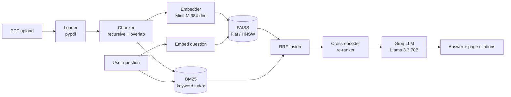

# 📄 DocMind RAG

**Chat with your PDFs. Get answers with page-level citations.**
A production-style Retrieval-Augmented Generation (RAG) app that combines **hybrid search (BM25 + vector)**, **FAISS HNSW indexing**, and **cross-encoder re-ranking**, powered by **Groq (Llama 3.3 70B)** and a **Streamlit** UI.


<!-- Add a screenshot or GIF here:  -->

---

## 🎯 The Problem

LLMs don't know your private documents, and basic "embed and search" RAG often fails:
- It misses exact terms like IDs, names, and error codes.
- The right chunk is found but ranked 7th, so the LLM never sees it.
- Answers come with no proof of where they came from.

## ✅ The Solution

DocMind fixes each problem with one technique:

| Problem | Technique used |
|---|---|
| Misses exact keywords | **Hybrid search**: BM25 + vector, merged with Reciprocal Rank Fusion |
| Right chunk ranked too low | **Cross-encoder re-ranking** |
| Slow search on big data | **FAISS HNSW** index (auto-switches to exact Flat for small data) |
| Hallucinations | Strict "use only the context" prompt + numbered citations `[1] [2]` |
| Can't tell what helps | **UI toggles** to turn hybrid and re-ranking on/off and compare |
| Long, noisy sources | **Compact evidence**: page chips + collapsed, shortened passages (full text on click) |

## 🏗️ Architecture



## 🧰 Tech Stack

| Layer | Tool |
|---|---|
| UI | Streamlit |
| PDF parsing | pypdf |
| Chunking | LangChain `RecursiveCharacterTextSplitter` |
| Embeddings | `sentence-transformers/all-MiniLM-L6-v2` |
| Vector search | FAISS (Flat + HNSW) |
| Keyword search | `rank-bm25` |
| Re-ranker | `cross-encoder/ms-marco-MiniLM-L-6-v2` |
| LLM | Groq, `llama-3.3-70b-versatile` |
| Tests | pytest |

## 📁 Project Structure

```
docmind-rag/
├── app.py                  # Streamlit UI (entry point)
├── .streamlit/config.toml  # dark theme + upload limit
├── docmind/                # core package
│   ├── config.py           # all settings in one place
│   ├── loader.py           # PDF -> pages
│   ├── chunker.py          # pages -> chunks
│   ├── embedder.py         # text -> vectors
│   ├── vector_store.py     # FAISS Flat / HNSW
│   ├── keyword_search.py   # BM25
│   ├── hybrid.py           # Reciprocal Rank Fusion
│   ├── reranker.py         # cross-encoder
│   ├── llm.py              # Groq answer generation
│   └── pipeline.py         # connects everything
├── tests/                  # unit tests
├── data/uploads/           # local files (git-ignored)
├── assets/                 # style.css + screenshots / demo GIF
├── .vscode/                # VS Code run + test config
├── .env.example
├── requirements.txt
└── README.md
```

## 🚀 Quick Start

```bash
# 1. clone
git clone https://github.com/YOUR_USERNAME/docmind-rag.git
cd docmind-rag

# 2. virtual environment
python -m venv .venv
source .venv/bin/activate        # Windows: .venv\Scripts\activate

# 3. install
pip install -r requirements.txt

# 4. add your free Groq key (https://console.groq.com)
cp .env.example .env             # Windows: copy .env.example .env
# open .env and paste GROQ_API_KEY

# 5. run
streamlit run app.py
```

The first run downloads the embedding and re-ranker models (~100 MB total). After that it starts fast.

## ✨ UI Features

- Custom dark theme with a clean, professional layout (CSS in `assets/style.css`)
- Guided 3-step onboarding and one-click starter questions
- Live knowledge-base stats (files, pages, chunks, index type)
- Answers show **source chips** (file · page). Evidence is collapsed and shortened, full passage on click
- Sidebar controls: hybrid on/off, re-ranking on/off, number of passages
- Speed badge on every answer and **chat export to Markdown**

## 💡 How to Use

1. Upload one or more PDFs in the sidebar.
2. Click **Build index**.
3. Ask questions in the chat box.
4. Open **Sources** under each answer to see the exact pages used.
5. Toggle **Hybrid** and **Re-ranking** to compare answer quality.

## ⚙️ How It Works (Short Version)

1. **Ingest:** PDF → pages → overlapping chunks → vectors. Stored in FAISS and in a BM25 index.
2. **Retrieve:** The question is searched by meaning (FAISS) and by exact words (BM25). The two ranked lists are merged with **RRF**: `score = Σ 1 / (60 + rank)`.
3. **Re-rank:** A cross-encoder reads each (question, chunk) pair and keeps the best 4.
4. **Generate:** The LLM answers using only those chunks and cites them.

**Why RRF?** BM25 scores and cosine scores are on different scales, so they cannot be added directly. RRF only uses the *rank*, so it merges them fairly.

**Why Flat vs HNSW?** Under 2,000 chunks, exact Flat search is instant and 100% accurate. Above that, HNSW stays fast with very little accuracy loss. The app picks automatically (`FLAT_LIMIT` in `config.py`).

## 🧪 Tests

```bash
pytest
```

## 🔧 Configuration

All defaults live in `docmind/config.py`. Override the common ones in `.env`:

| Variable | Default | Meaning |
|---|---|---|
| `GROQ_API_KEY` | none | Required |
| `LLM_MODEL` | `llama-3.3-70b-versatile` | Groq model |
| `CHUNK_SIZE` | `800` | Characters per chunk |
| `CHUNK_OVERLAP` | `100` | Overlap between chunks |

## ⚠️ Known Limitations

- Scanned PDFs (images) are not supported yet. No OCR.
- Index lives in memory and is rebuilt per session.
- Single-turn Q&A (no follow-up question rewriting yet).

## 🗺️ Roadmap

- [ ] OCR for scanned PDFs
- [ ] Persist the index to disk
- [ ] Conversation memory + question rewriting
- [ ] Evaluation script (hit-rate / MRR) to measure each technique
- [ ] Docker + deploy to Streamlit Cloud

## 👤 Author

**Mustafa Amjad**
[LinkedIn](https://www.linkedin.com/in/mustafaamjad9)

## 📜 License

MIT. See [LICENSE](LICENSE).
