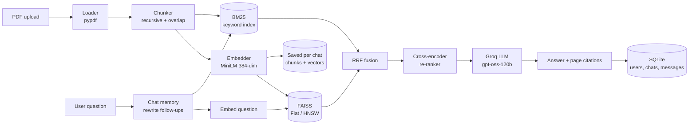

# DocMind RAG

**Live demo:** [docmind-mustafa.streamlit.app](https://docmind-mustafa.streamlit.app)

**Chat with your PDFs. Get answers with page-level citations. Your chats are saved.**
A production-style Retrieval-Augmented Generation (RAG) app with **hybrid search (BM25 + vector)**, **FAISS HNSW indexing**, **cross-encoder re-ranking**, **chat memory**, **user accounts**, and **saved / pinned chats**. Powered by **Groq (gpt-oss-120b)** and **Streamlit**.


<!-- Add a screenshot or GIF here:  -->

---

## The Problem

LLMs don't know your private documents, and basic "embed and search" RAG often fails:
- It misses exact terms like IDs, names, and error codes.
- The right chunk is found but ranked 7th, so the LLM never sees it.
- Follow-up questions like "and for gift cards?" lose their meaning.
- Answers come with no proof of where they came from.
- Every refresh throws away your work.

## The Solution

| Problem | Technique used |
|---|---|
| Misses exact keywords | **Hybrid search**: BM25 + vector, merged with Reciprocal Rank Fusion |
| Right chunk ranked too low | **Cross-encoder re-ranking** |
| Slow search on big data | **FAISS HNSW** index (auto-switches to exact Flat for small data) |
| Hallucinations | Strict "use only the context" prompt + numbered citations `[1] [2]` |
| Follow-up questions fail | **Chat memory**: the question is rewritten to a standalone one before searching |
| Work lost on refresh | **Accounts + SQLite**: chats, pins and document indexes are saved |
| Can't tell what helps | **UI toggles** to turn hybrid, re-ranking and memory on/off |
| Long, noisy sources | **Compact evidence**: page chips + collapsed, shortened passages |

## Architecture



## Features

**Documents**
- PDF, **DOCX**, **TXT/MD**, **HTML**, **images** (PNG, JPG, WEBP, BMP, GIF, multi-page TIFF) and **web links** (page, PDF, Word file or image). For non-PDF files the citation "page" is the section number
- **Tables** in PDF, DOCX and HTML are kept row by row, with every value labelled by its column header (`Region: North | Sales: 120`), so table questions stay answerable after chunking
- Web links are limited to public sites: localhost, private networks and cloud metadata addresses are blocked, redirects are re-checked, downloads are capped at 10 MB

- **OCR for scans and pictures** (pure pip, installed with the app, can be switched off per upload): scanned PDF pages, image files, and the words inside charts and screenshots embedded in PDF and Word files. Mixed PDFs (typed + scanned pages) are handled page by page. Tiny icons and repeated logos are skipped. Evidence shows "OCR" / "Picture" badges because recognised text can contain small errors
- **AI description of charts and diagrams** (optional toggle): each picture is sent to a Groq vision model (`VISION_MODEL`, default `qwen/qwen3.8-27b`) and its description is indexed, so "what does the chart on page 4 show?" can be answered

**Chunking**
- Each page is split at its headings first (numbered titles like "2. Returns and refunds", Markdown `#`, ALL-CAPS titles), so one chunk never mixes two sections. A contents list stays together
- Sections longer than 800 characters (about 200 tokens) are cut at paragraphs, then lines, then sentences, with a 100-character overlap. Every chunk keeps its file name and page

**Retrieval**
- Retrieve wide, then re-rank: BM25 and vector search each return their top 20, Reciprocal Rank Fusion merges them, and a cross-encoder re-ranks the 20 candidates and keeps the best 4 for the AI (adjustable 1–8)
- **Choose the files to search:** untick a document card ("Use in answers") to leave it out. The filter is applied inside both searches (a FAISS ID selector and masked BM25 scores), so the top 20 always come from the chosen files
- Flat or HNSW index chosen automatically by corpus size

**Chats and accounts**
- Sign up / log in (passwords stored as salted PBKDF2 hashes, never in plain text)
- **Stay logged in** for 30 days, even after a browser refresh
- **Forgot password:** one-time recovery code shown at signup, reset any time with username + code (the code is replaced after each use). Logged-in users can change their password and generate a new code
- **Brute-force protection:** 5 wrong attempts locks login, reset and password change for 15 minutes
- **New chat**, **Recent chats**, **Pinned chats**, one-click switching, rename, delete (with confirmation)
- Each chat keeps its own documents. Reopen an old chat and keep asking. No re-upload, no re-embedding
- Add more PDFs to a chat or replace them
- Chat memory understands follow-up questions and shows "Searched for: ..."
- Users can only see their own chats (every query is scoped by user id)

**Interface** (Streamlit app)
- Three panes: chats on the left (reading options, Pinned / Recents with a "..." menu to pin, rename, export or delete, and the account row), the conversation in the middle, the chat's documents as a grid of cards on the right
- Attach files with the **+** in the message box (or add a link on the right). Under the box: a **model picker** (the answer models Groq offers, listed live) and the **tokens** the last answer used out of the model's context window
- Click a source under an answer to open the page in a pop-up with the cited sentence highlighted
- **Voice:** tap the mic in the message box and ask out loud. Whisper on Groq (`whisper-large-v3-turbo`) transcribes it, the transcript appears as your message (tagged "Spoken"), and the answer is read back with the browser's speech voice. Turn on **Read aloud** to hear every answer, or press **Listen** under any answer
- Ivory, emerald and orange theme (`.streamlit/config.toml` + `assets/docmind.css`), Material icons, one-click starter questions
- Export any chat to Markdown

## Tech Stack

| Layer | Tool |
|---|---|
| UI | Streamlit + custom CSS |
| Storage | SQLite (stdlib) + files on disk |
| Document parsing | pypdf, pdfplumber (tables), python-docx, BeautifulSoup, Pillow |
| OCR | pypdfium2 + RapidOCR (`rapidocr` + ONNX Runtime) |
| Chart / diagram description (optional) | Groq vision model (`VISION_MODEL`) |
| Chunking | LangChain `RecursiveCharacterTextSplitter` |
| Embeddings | `sentence-transformers/all-MiniLM-L6-v2` |
| Vector search | FAISS (Flat + HNSW) |
| Keyword search | `rank-bm25` |
| Re-ranker | `cross-encoder/ms-marco-MiniLM-L-6-v2` |
| LLM | Groq, `openai/gpt-oss-120b` |
| Tests | pytest |

## Project Structure

```
docmind-rag/
├── server.py               # web app API (FastAPI) + serves the React front end
├── web/                    # React + TypeScript front end (Vite)
├── app.py                  # Streamlit UI (the original demo)
├── docmind/                # core package
│   ├── config.py           # all settings in one place
│   ├── db.py               # SQLite: users, chats, messages
│   ├── auth.py             # sign up / log in (PBKDF2) + login sessions
│   ├── cookies.py          # read / write the 'stay logged in' cookie
│   ├── loader.py           # PDF / DOCX / TXT / HTML / images / URL -> pages (tables + pictures)
│   ├── ocr.py              # OCR for scanned pages and pictures
│   ├── chunker.py          # pages -> chunks
│   ├── embedder.py         # text -> vectors
│   ├── vector_store.py     # FAISS Flat / HNSW
│   ├── keyword_search.py   # BM25
│   ├── hybrid.py           # Reciprocal Rank Fusion
│   ├── reranker.py         # cross-encoder
│   ├── llm.py              # question rewrite + answer generation
│   ├── evidence.py         # finds the cited sentences and their place on the PDF page
│   └── pipeline.py         # connects everything, save / load
├── scripts/evaluate.py     # Hit@k and MRR for 4 retrieval setups
├── scripts/eval_answers.py # end-to-end answer test (24 questions, expected answers + citations)
├── eval/                   # answer test set, its sample documents, last run
├── tests/                  # unit tests
├── data/                   # saved accounts, chats, indexes (git-ignored)
├── assets/                 # screenshots / demo GIF
├── .streamlit/config.toml  # light/dark theme + upload limit
├── .vscode/                # VS Code run + test config
├── Dockerfile  docker-compose.yml  .dockerignore
├── NOTICE  THIRD_PARTY_LICENSES.md  LICENSE
├── .env.example  requirements.txt
└── README.md
```

## Quick Start

```bash
git clone https://github.com/YOUR_USERNAME/docmind-rag.git
cd docmind-rag

python -m venv .venv
source .venv/bin/activate        # Windows: .venv\Scripts\activate
pip install -r requirements.txt   # includes OCR for scans, images and text in charts

cp .env.example .env             # Windows: copy .env.example .env
# open .env and paste GROQ_API_KEY (free key: https://console.groq.com)

# the web app (landing page, workspaces, source viewer)
cd web && npm install && npm run build && cd ..
uvicorn server:app --port 8000   # open http://localhost:8000

# or the original Streamlit demo
streamlit run app.py
```

The first run downloads the embedding and re-ranker models (~100 MB). Then create an account, add documents to a workspace, and ask.

For front-end work, run `uvicorn server:app --port 8000` and `cd web && npm run dev` (http://localhost:5173 forwards `/api` to the server).

### Web app

- **Workspaces:** each holds its documents, index and every question asked, saved per account.
- **Source viewer:** click a citation to see the real PDF page with the cited sentences highlighted. Scanned pages show the scan and the OCR text; Word, text and web sources show the passage with the sentences marked.
- **Library:** drag-and-drop or paste a link, with per-file progress and how each file was read (Text, Table, Picture, OCR).
- **Sign-in:** an HttpOnly session cookie that survives reloads (30 days), set by the server.
- **API docs:** `http://localhost:8000/api/docs`.

### Docker

```bash
cp .env.example .env             # add your GROQ_API_KEY
docker compose up --build
# open http://localhost:8000
```

Accounts, chats and indexes are stored in the `docmind-data` volume, so they survive restarts.

## How to Use

1. Create an account and log in.
2. Attach files with the **+** in the message box (or paste a link in the Documents panel on the right) and ask a question in the same message.
3. Ask follow-ups. Questions like "what about for gift cards?" work.
4. Click a source under an answer to see the page with the cited sentence highlighted; open **Passages used** for every passage.
5. Pin important chats, start a **New chat** for other documents, switch any time from the sidebar.

## How It Works (Short Version)

1. **Ingest:** PDF → pages → overlapping chunks → vectors. Saved to disk per chat and loaded into FAISS + BM25.
2. **Memory:** For follow-ups, the LLM rewrites your question into a standalone one using the last few messages.
3. **Retrieve:** Search by meaning (FAISS) and by exact words (BM25), merge with **RRF**: `score = Σ 1 / (60 + rank)`.
4. **Re-rank:** A cross-encoder reads each (question, chunk) pair and keeps the best few.
5. **Generate:** The LLM answers using only those chunks, cites them, and the exchange is saved to SQLite.

**Why RRF?** BM25 and cosine scores are on different scales, so they cannot be added. RRF only uses the *rank*.

**Why save vectors?** Reopening a chat loads `chunks.json` + `vectors.npy` and rebuilds the indexes. No PDF parsing or embedding again.

## Evaluation

**Answer test (end to end).** `eval/answers.json` holds 24 questions about the five sample documents in `eval/docs` (a fictional company: a policy handbook PDF, a Word file with a table and a chart, a scanned notice, a text file, a staff-benefits Word file). Each question has the text the answer must contain, the file and page it must cite, or "must say it couldn't find that". They include follow-ups, chart and table questions, false premises, details the documents don't mention, and a prompt injection. Re-run it after any change to chunking, retrieval or the prompt:

```bash
python scripts/eval_answers.py      # needs GROQ_API_KEY in .env; prints PASS/FAIL per question
```

The latest result is saved in `eval/last_run.json` (date, model, settings, every answer and what it cited).

Results for the models in the picker: gpt-oss-120b 24/24 (the default, run 2026-11-16), qwen3.8-27b 24/24 and gpt-oss-20b 23/24 (run 2026-11-17) (on "a jacket I bought with a coupon" it said the coupon doesn't change the return period instead of saying the documents don't mention coupons).

**Retrieval only.** Measure what hybrid search and re-ranking actually add on **your** documents (no Groq key needed):

```bash
cp eval/questions.example.json eval/questions.json   # edit with your own questions
python scripts/evaluate.py --pdf data/uploads/your.pdf --questions eval/questions.json --k 4
```

Each question needs `must_contain` (text the right chunk must include) or `expected_page`. The script prints **Hit@k** and **MRR** for Vector only, Vector + Re-rank, Hybrid, and Hybrid + Re-rank, and saves `eval/results.csv`.

<!-- Paste your real results table here after running it on a public sample PDF. -->

## Tests

```bash
pytest
```

Covers chunking, BM25, RRF, accounts, chat isolation between users, pinning, cascade delete, and save / load of an index.

## Configuration

All defaults live in `docmind/config.py`. Override the common ones in `.env`:

| Variable | Default | Meaning |
|---|---|---|
| `GROQ_API_KEY` | none | Required |
| `LLM_MODEL` | `openai/gpt-oss-120b` | Groq model |
| `CHUNK_SIZE` | `800` | Characters per chunk |
| `CHUNK_OVERLAP` | `100` | Overlap between chunks |

## Privacy and Security

- Passwords and recovery codes are stored only as salted PBKDF2-SHA256 hashes.
- Changing or resetting a password logs out every other device. The lockout is per username, so someone could deliberately lock a known username for 15 minutes. That is the trade-off for stopping password guessing.
- Chats and the **extracted text** of your PDFs are saved in `data/` on the machine running the app (not the original PDF files).
- Document passages and questions are sent to Groq to generate answers. Read Groq's terms and data policy before using confidential documents.
- Deleting a chat deletes its messages and its saved index.
- "Stay logged in" uses a random token in a browser cookie (30 days). Only a hash of the token is stored on the server, and logout invalidates it immediately. The cookie is set from JavaScript, so it cannot be `HttpOnly`. Use HTTPS if you deploy publicly (the `Secure` flag is added automatically on https).

## Licenses

- This project: MIT (see `LICENSE`).
- The default answer model, OpenAI's gpt-oss-120b (served by Groq), is released under Apache 2.0.
- Other components are listed in `THIRD_PARTY_LICENSES.md`. Verify each one before commercial use.

## Known Limitations

- OCR is slower than reading a text layer, and limited to 50 scanned pages and 40 pictures per file. Handwriting and low-quality scans can give wrong text.
- OCR copies the words in a picture; it does not understand a chart. For that, turn on AI description (up to 20 pictures per file, uses Groq quota, and the model can misread values, so check the original for exact numbers).
- PDF tables are found from their ruling lines. Tables drawn without lines are read as plain text. Pictures inside HTML pages are represented by their alt text only.
- Password reset needs your saved recovery code (there is no email service). Lose both password and code and the account cannot be recovered.
- Web-link download checks the address before connecting, but a determined DNS-rebinding attack is not fully ruled out. Keep the URL feature behind login (it is) and run the app without access to internal networks.

## Roadmap

- [ ] Email-based password reset (needs an email service)
- [ ] Streaming answers
- [ ] Local LLM option (Ollama) for fully private use
- [ ] FastAPI endpoint and embeddable widget

## Author

**Mustafa Amjad**
[LinkedIn](https://www.linkedin.com/in/mustafaamjad9)

## License

MIT. See [LICENSE](LICENSE).
