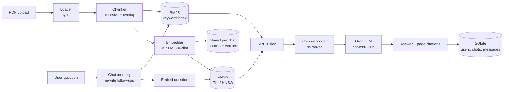

# DocMind RAG

**Live demo:** [docmind-mustafa.streamlit.app](https://docmind-mustafa.streamlit.app)

**Chat with your PDFs. Get answers with page-level citations. Your chats are saved.**
A production-style Retrieval-Augmented Generation (RAG) app with **hybrid search (BM25 + vector)**, **FAISS HNSW indexing**, **cross-encoder re-ranking**, **chat memory**, **user accounts**, and **saved / pinned chats**. Powered by **Groq (Llama 3.3 70B)** and **Streamlit**.


<!-- Add a screenshot or GIF here:  -->

---

## The Problem

LLMs don't know your private documents, and basic "embed and search" RAG often fails:
- It misses exact terms like IDs, names, and error codes.
- The right chunk is found but ranked 7th, so the LLM never sees it.
- Follow-up questions like "and for gift cards?" lose their meaning.
- Answers come with no proof of where they came from.
- Every refresh throws away your work.

## The Solution

| Problem | Technique used |
|---|---|
| Misses exact keywords | **Hybrid search**: BM25 + vector, merged with Reciprocal Rank Fusion |
| Right chunk ranked too low | **Cross-encoder re-ranking** |
| Slow search on big data | **FAISS HNSW** index (auto-switches to exact Flat for small data) |
| Hallucinations | Strict "use only the context" prompt + numbered citations `[1] [2]` |
| Follow-up questions fail | **Chat memory**: the question is rewritten to a standalone one before searching |
| Work lost on refresh | **Accounts + SQLite**: chats, pins and document indexes are saved |
| Can't tell what helps | **UI toggles** to turn hybrid, re-ranking and memory on/off |
| Long, noisy sources | **Compact evidence**: page chips + collapsed, shortened passages |

## Architecture



## Features

**Documents**
- PDF, **DOCX**, **TXT/MD**, **HTML**, **images** (PNG, JPG, WEBP, BMP, GIF, multi-page TIFF) and **web links** (page, PDF, Word file or image). For non-PDF files the citation "page" is the section number
- **Tables** in PDF, DOCX and HTML are kept row by row, with every value labelled by its column header (`Region: North | Sales: 120`), so table questions stay answerable after chunking
- Web links are limited to public sites: localhost, private networks and cloud metadata addresses are blocked, redirects are re-checked, downloads are capped at 10 MB

- **OCR for scans and pictures** (pure pip, installed with the app, can be switched off per upload): scanned PDF pages, image files, and the words inside charts and screenshots embedded in PDF and Word files. Mixed PDFs (typed + scanned pages) are handled page by page. Tiny icons and repeated logos are skipped. Evidence shows "OCR" / "Picture" badges because recognised text can contain small errors
- **AI description of charts and diagrams** (optional toggle): each picture is sent to a Groq vision model (`VISION_MODEL`, default `qwen/qwen3.8-27b`) and its description is indexed, so "what does the chart on page 4 show?" can be answered

**Retrieval**
- Hybrid search (BM25 + vectors) with RRF, optional cross-encoder re-ranking
- Flat or HNSW index chosen automatically by corpus size
- Adjustable number of passages sent to the AI

**Chats and accounts**
- Sign up / log in (passwords stored as salted PBKDF2 hashes, never in plain text)
- **Stay logged in** for 30 days, even after a browser refresh
- **Forgot password:** one-time recovery code shown at signup, reset any time with username + code (the code is replaced after each use). Logged-in users can change their password and generate a new code
- **Brute-force protection:** 5 wrong attempts locks login, reset and password change for 15 minutes
- **New chat**, **Recent chats**, **Pinned chats**, one-click switching, rename, delete (with confirmation)
- Each chat keeps its own documents. Reopen an old chat and keep asking. No re-upload, no re-embedding
- Add more PDFs to a chat or replace them
- Chat memory understands follow-up questions and shows "Understood as: ..."
- Users can only see their own chats (every query is scoped by user id)

**Interface**
- Clean light/dark theme defined in `.streamlit/config.toml` (no custom CSS), Material icons, one-click starter questions
- Source chips (file · page), collapsed evidence, speed badge on every answer
- Export any chat to Markdown

## Tech Stack

| Layer | Tool |
|---|---|
| UI | Streamlit + custom CSS |
| Storage | SQLite (stdlib) + files on disk |
| Document parsing | pypdf, pdfplumber (tables), python-docx, BeautifulSoup, Pillow |
| OCR | pypdfium2 + RapidOCR (`rapidocr` + ONNX Runtime) |
| Chart / diagram description (optional) | Groq vision model (`VISION_MODEL`) |
| Chunking | LangChain `RecursiveCharacterTextSplitter` |
| Embeddings | `sentence-transformers/all-MiniLM-L6-v2` |
| Vector search | FAISS (Flat + HNSW) |
| Keyword search | `rank-bm25` |
| Re-ranker | `cross-encoder/ms-marco-MiniLM-L-6-v2` |
| LLM | Groq, `openai/gpt-oss-120b` |
| Tests | pytest |

## Project Structure

```
docmind-rag/
├── app.py                  # Streamlit UI (entry point)
├── docmind/                # core package
│   ├── config.py           # all settings in one place
│   ├── db.py               # SQLite: users, chats, messages
│   ├── auth.py             # sign up / log in (PBKDF2) + login sessions
│   ├── cookies.py          # read / write the 'stay logged in' cookie
│   ├── loader.py           # PDF / DOCX / TXT / HTML / images / URL -> pages (tables + pictures)
│   ├── ocr.py              # OCR for scanned pages and pictures
│   ├── chunker.py          # pages -> chunks
│   ├── embedder.py         # text -> vectors
│   ├── vector_store.py     # FAISS Flat / HNSW
│   ├── keyword_search.py   # BM25
│   ├── hybrid.py           # Reciprocal Rank Fusion
│   ├── reranker.py         # cross-encoder
│   ├── llm.py              # question rewrite + answer generation
│   └── pipeline.py         # connects everything, save / load
├── scripts/evaluate.py     # Hit@k and MRR for 4 retrieval setups
├── eval/                   # example test questions
├── tests/                  # unit tests
├── data/                   # saved accounts, chats, indexes (git-ignored)
├── assets/                 # screenshots / demo GIF
├── .streamlit/config.toml  # light/dark theme + upload limit
├── .vscode/                # VS Code run + test config
├── Dockerfile  docker-compose.yml  .dockerignore
├── NOTICE  THIRD_PARTY_LICENSES.md  LICENSE
├── .env.example  requirements.txt
└── README.md
```

## Quick Start

```bash
git clone https://github.com/YOUR_USERNAME/docmind-rag.git
cd docmind-rag

python -m venv .venv
source .venv/bin/activate        # Windows: .venv\Scripts\activate
pip install -r requirements.txt   # includes OCR for scans, images and text in charts

cp .env.example .env             # Windows: copy .env.example .env
# open .env and paste GROQ_API_KEY (free key: https://console.groq.com)

streamlit run app.py
```

The first run downloads the embedding and re-ranker models (~100 MB). Then create an account, upload PDFs, and ask.

### Docker

```bash
cp .env.example .env             # add your GROQ_API_KEY
docker compose up --build
# open http://localhost:8501
```

Accounts, chats and indexes are stored in the `docmind-data` volume, so they survive restarts.

## How to Use

1. Create an account and log in.
2. Open **Documents** in the sidebar, upload files (or paste a link), click **Build index**.
3. Ask questions. Follow-ups like "what about for gift cards?" work.
4. Pin important chats, start a **New chat** for other documents, switch any time from the sidebar.
5. Open **View evidence** under an answer to see the exact pages used.

## How It Works (Short Version)

1. **Ingest:** PDF → pages → overlapping chunks → vectors. Saved to disk per chat and loaded into FAISS + BM25.
2. **Memory:** For follow-ups, the LLM rewrites your question into a standalone one using the last few messages.
3. **Retrieve:** Search by meaning (FAISS) and by exact words (BM25), merge with **RRF**: `score = Σ 1 / (60 + rank)`.
4. **Re-rank:** A cross-encoder reads each (question, chunk) pair and keeps the best few.
5. **Generate:** The LLM answers using only those chunks, cites them, and the exchange is saved to SQLite.

**Why RRF?** BM25 and cosine scores are on different scales, so they cannot be added. RRF only uses the *rank*.

**Why save vectors?** Reopening a chat loads `chunks.json` + `vectors.npy` and rebuilds the indexes. No PDF parsing or embedding again.

## Evaluation

Measure what hybrid search and re-ranking actually add on **your** documents (no Groq key needed):

```bash
cp eval/questions.example.json eval/questions.json   # edit with your own questions
python scripts/evaluate.py --pdf data/uploads/your.pdf --questions eval/questions.json --k 4
```

Each question needs `must_contain` (text the right chunk must include) or `expected_page`. The script prints **Hit@k** and **MRR** for Vector only, Vector + Re-rank, Hybrid, and Hybrid + Re-rank, and saves `eval/results.csv`.

<!-- Paste your real results table here after running it on a public sample PDF. -->

## Tests

```bash
pytest
```

Covers chunking, BM25, RRF, accounts, chat isolation between users, pinning, cascade delete, and save / load of an index.

## Configuration

All defaults live in `docmind/config.py`. Override the common ones in `.env`:

| Variable | Default | Meaning |
|---|---|---|
| `GROQ_API_KEY` | none | Required |
| `LLM_MODEL` | `openai/gpt-oss-120b` | Groq model |
| `CHUNK_SIZE` | `800` | Characters per chunk |
| `CHUNK_OVERLAP` | `100` | Overlap between chunks |

## Privacy and Security

- Passwords and recovery codes are stored only as salted PBKDF2-SHA256 hashes.
- Changing or resetting a password logs out every other device. The lockout is per username, so someone could deliberately lock a known username for 15 minutes. That is the trade-off for stopping password guessing.
- Chats and the **extracted text** of your PDFs are saved in `data/` on the machine running the app (not the original PDF files).
- Document passages and questions are sent to Groq to generate answers. Read Groq's terms and data policy before using confidential documents.
- Deleting a chat deletes its messages and its saved index.
- "Stay logged in" uses a random token in a browser cookie (30 days). Only a hash of the token is stored on the server, and logout invalidates it immediately. The cookie is set from JavaScript, so it cannot be `HttpOnly`. Use HTTPS if you deploy publicly (the `Secure` flag is added automatically on https).

## Licenses

- This project: MIT (see `LICENSE`).
- The default answer model, OpenAI's gpt-oss-120b (served by Groq), is released under Apache 2.0.
- Other components are listed in `THIRD_PARTY_LICENSES.md`. Verify each one before commercial use.

## Known Limitations

- OCR is slower than reading a text layer, and limited to 50 scanned pages and 40 pictures per file. Handwriting and low-quality scans can give wrong text.
- OCR copies the words in a picture; it does not understand a chart. For that, turn on AI description (up to 20 pictures per file, uses Groq quota, and the model can misread values, so check the original for exact numbers).
- PDF tables are found from their ruling lines. Tables drawn without lines are read as plain text. Pictures inside HTML pages are represented by their alt text only.
- Password reset needs your saved recovery code (there is no email service). Lose both password and code and the account cannot be recovered.
- Web-link download checks the address before connecting, but a determined DNS-rebinding attack is not fully ruled out. Keep the URL feature behind login (it is) and run the app without access to internal networks.

## Roadmap

- [ ] Email-based password reset (needs an email service)
- [ ] Streaming answers
- [ ] Local LLM option (Ollama) for fully private use
- [ ] FastAPI endpoint and embeddable widget

## Author

**Mustafa Amjad**
[LinkedIn](https://www.linkedin.com/in/mustafaamjad9)

## License

MIT. See [LICENSE](LICENSE).
